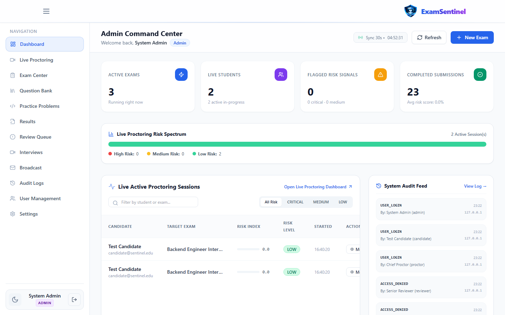
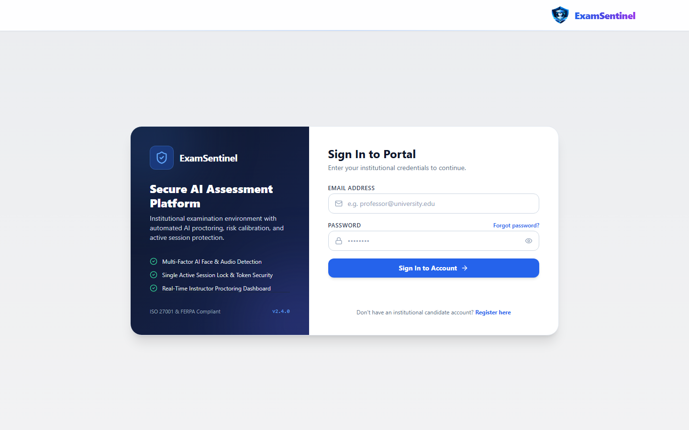
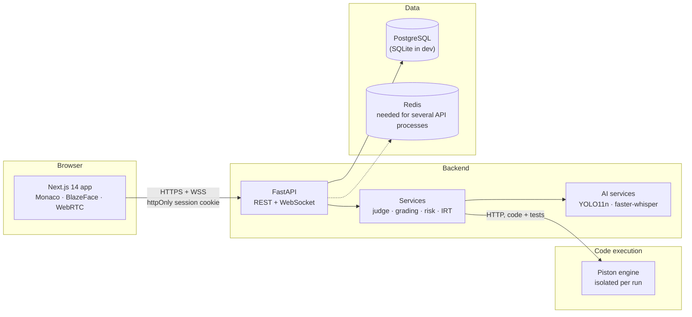

<div align="center">


# ExamSentinel

**Secure online assessments with AI-assisted proctoring and a built-in coding practice platform.**

[](https://github.com/vishwa-10147/ExamSentiinel/actions/workflows/ci.yml)


[](LICENSE)

[Features](#features) ·
[Screenshots](#screenshots) ·
[Getting started](#getting-started) ·
[Architecture](#architecture) ·
[Deployment](#deployment) ·
[Documentation](#documentation)

<br />


</div>

---

## Overview

ExamSentinel is a full-stack platform for running proctored exams and coding assessments.
Institutions build exams from a question bank, candidates take them in the browser while
integrity signals are collected, and human reviewers make every final decision. Alongside
exams, students get a LeetCode-style practice platform with **116 data-structures and
algorithms problems** and **11 SQL problems**, judged by real compilers in an isolated sandbox.

AI is used to *surface* signals — never to penalise a candidate automatically.

**Who it is for:** colleges and training organisations that run exams in computer labs or
remotely (administrators, proctors, reviewers) and the students who take them.

**The problem it solves:** online exams need integrity checks, coding questions need a safe
way to run untrusted code, and students need practice between exams. ExamSentinel puts exams,
proctoring, human review, a judged practice platform and contests in one self-hostable system
that can run on a single campus server without internet access during exams.

## Contents

- [Features](#features) · [Project status](#project-status) · [Screenshots](#screenshots)
- [Architecture](#architecture) · [Tech stack](#tech-stack) · [Project structure](#project-structure)
- [Getting started](#getting-started) · [Configuration](#configuration) · [Database](#database)
- [Testing](#testing) · [Code quality and CI](#code-quality-and-ci) · [Deployment](#deployment)
- [Troubleshooting](#troubleshooting) · [Security](#security) · [Documentation](#documentation)
- [Roadmap](#roadmap) · [Contributing](#contributing) · [License](#license)

## Features

### Assessments
- Exam builder with MCQ, short answer, essay, coding and SQL questions; scheduling windows and enrolment
- Timed sessions with server-side timing, auto-save and automatic submission at the deadline
- Coding questions graded against hidden tests; any practice problem can be added to an exam
- Results, leaderboards and CSV export; one session per exam and candidate, resumed after a
  disconnect, with answers kept in the browser until the server confirms them

### Proctoring and review
- Browser telemetry: tab switches, fullscreen exits, copy/paste, multiple sessions
- Webcam analysis: phone and additional-person detection (YOLO11n), face presence (BlazeFace, in-browser)
- Weighted, advisory risk score (Low → Critical) that opens a review case
- Live proctor console, reviewer queue with evidence, and a complete audit log

### Coding practice
- **116 DSA problems** across 16 topics, plus 11 SQL problems — each with formats, constraints,
  samples, hidden tests, hints, complexity and an editorial
- Monaco editor with starter code in Python, JavaScript, Java, C++ and C (LeetCode-style C signatures)
- **Run** against samples and custom input; **Submit** against every hidden test, through a
  judging queue load-tested with 500 simultaneous submissions
- Verdicts: Accepted, Wrong Answer, Time/Memory/Output Limit Exceeded, Runtime Error, Compile Error
- Topic and difficulty filters, search by ID, submission history and per-topic progress
- Code playground for any C, C++, Java, Python, JavaScript or SQL program with custom stdin
- **Timed contests** with registration, a countdown, points and penalties, and a live leaderboard

### Interviews and accounts
- Live WebRTC interviews with consent capture, rubric scoring and Whisper transcription
- Email/password and OpenID Connect single sign-on (Google, Microsoft, any OIDC provider)
- Role-based access for Admin, Proctor, Reviewer and Candidate

## Project status

| Area | Status |
|---|---|
| Exams, proctoring, review, practice, contests, interviews, SSO | Implemented and covered by automated tests |
| Local development (Windows) and the Docker Compose stack | Verified |
| Campus server kit (`deploy/campus/`) | Verified in a local rehearsal on Docker Desktop; not yet run on a real campus server |
| AWS deployment | Topology rehearsed locally (`deploy/rehearsal/`); not yet deployed to a real AWS account |
| Item-response-theory scoring (`backend/app/services/irt_service.py`) | Service code only; not exposed through the API or UI |
| macOS on Apple Silicon | Untested (the code-execution engine image is amd64-only) |

Known limitations are listed in [Production readiness](docs/PRODUCTION_READINESS.md#known-limitations)
and [Security](docs/SECURITY.md#known-gaps).

## Screenshots

| | |
|:---:|:---:|
|  |  |
| **Problem set** — filters, topics and progress | **Practice progress** — by topic, with full history |
|  |  |
| **Code playground** — any program, custom stdin | **Problem authoring** — validate, publish, add to exams |
|  |  |
| **Proctor console** — live sessions and risk | **Reviewer dashboard** — human-in-the-loop decisions |
|  |  |
| **Admin dashboard** — exams, users and activity | **Sign in** — password or single sign-on |

Screenshots are generated from a running local instance with
[`frontend/scripts/capture-screenshots.mjs`](frontend/scripts/capture-screenshots.mjs).

## Architecture



User code never runs in the API process: every run goes to a self-hosted
[Piston](https://github.com/engineer-man/piston) engine that isolates it with no network,
a non-root user and CPU, memory, process, output and file-size limits. Details in
[Architecture](docs/ARCHITECTURE.md) and [Code execution](docs/CODE_EXECUTION.md).

Live proctoring events, interview signalling and rate limits are shared between API processes
through Redis; a single process falls back to memory. Practice submissions go through a
database-backed judging queue, so a restarted process loses no submission.

## Tech stack

| Layer | Technologies |
|---|---|
| Frontend | Next.js 14 (App Router), React 18, TypeScript, Tailwind CSS, Monaco Editor |
| Backend | Python 3.12, FastAPI, Pydantic v2, SQLAlchemy 2 (async), Alembic |
| Data | PostgreSQL 16 (production), SQLite (local development), Redis 7 |
| Code execution | Piston — Python 3.12, Node 20, Java 15, GCC 10.2 (C/C++), SQLite 3.36 |
| AI | Ultralytics YOLO11n, BlazeFace (TensorFlow.js), faster-whisper |
| Testing | pytest, Playwright, end-to-end scripts against live servers |
| Infrastructure | Docker Compose, nginx (campus server), AWS (ECS, EC2, RDS, ElastiCache, S3), GitHub Actions |

## Project structure

```
ExamSentinel/
├── backend/
│   ├── app/               # FastAPI application: api/, core/, models/, schemas/, services/
│   ├── practice_bank/     # DSA and SQL question bank
│   ├── alembic/           # Database migrations (PostgreSQL)
│   └── tests/             # pytest suites
├── frontend/
│   ├── app/               # Next.js routes: admin/, candidate/, proctor/, reviewer/, exam/, auth/
│   ├── components/        # Shared UI components
│   ├── services/          # API client
│   └── tests/             # Playwright specs
├── ai/                    # Standalone AI modules and model weights
├── infra/piston/          # Code-execution engine image
├── scripts/               # Seeding, runtime installation, end-to-end checks
├── deploy/                # campus/ (one-server kit), rehearsal/ (AWS topology locally)
├── docs/                  # Documentation
├── docker-compose.yml     # Full stack for evaluation
├── docker-compose.piston.yml  # Code-execution engine only (local development)
├── docker-compose.prod.yml    # Single-host production (AWS option B)
├── SETUP.md               # Installation guide
└── start-local.cmd        # One-command local start (Windows)
```

## Getting started

### Prerequisites

| Tool | Version |
|---|---|
| Operating system | Windows 10/11 (verified), Linux x86-64, macOS (Intel; Apple Silicon untested) |
| Python | 3.12 |
| Node.js | 20 LTS or newer |
| Docker | Docker Desktop or Docker Engine with Compose (runs the code-execution engine) |

### Quick start on Windows

```bat
git clone https://github.com/vishwa-10147/ExamSentiinel.git
cd ExamSentiinel
start-local.cmd
```

`start-local.cmd` creates the virtual environment and configuration on first run, starts the
code-execution engine, the API and the web app, seeds demo data, waits until everything is
healthy and opens the browser. Stop everything with `start-local.cmd stop`.

### Other ways to run it

| Goal | Guide |
|---|---|
| Step-by-step setup on Windows, Linux or macOS (SQLite) | [Setup: Option B](SETUP.md#option-b-manual-setup-on-windows-linux-or-macos) |
| The whole stack in Docker (PostgreSQL, Redis, production build of the web app) | [Setup: Option C](SETUP.md#option-c-the-whole-stack-in-docker) |
| A college server for real exams | [Campus server](deploy/campus/README.md) |
| AWS | [AWS deployment](docs/AWS_DEPLOYMENT.md) |

After starting, open <http://localhost:3000>. In development the interactive API reference is at
<http://localhost:8000/docs> (it is disabled when `DEBUG=false`); see also the
[API reference](docs/API.md).

### Demo accounts

`seed_admin.py` creates these accounts in **development only** (production seeds a single
admin from `ADMIN_EMAIL` / `ADMIN_PASSWORD`):

| Role | Email | Password |
|---|---|---|
| Admin | `admin@sentinel.edu` | `DemoPass123!` |
| Proctor | `proctor@sentinel.edu` | `DemoPass123!` |
| Reviewer | `reviewer@sentinel.edu` | `DemoPass123!` |
| Candidate | `candidate@sentinel.edu` | `DemoPass123!` |

Each account allows one active session; signing in elsewhere ends the previous one.

## Configuration

All settings are environment variables; [`.env.example`](.env.example) is the template
(placeholders only) and [Configuration](docs/CONFIGURATION.md) documents every variable. The
most important:

| Variable | Purpose | Development default |
|---|---|---|
| `SECRET_KEY` | Signs sessions and evidence links | development key (production requires a random one) |
| `DATABASE_URL` | Database connection | SQLite file in `backend/` |
| `REDIS_URL` | Shared state between API processes | `redis://localhost:6379/0` (optional for one process) |
| `PISTON_URL` | Code-execution engine | `http://127.0.0.1:2000/api/v2/execute` |
| `CORS_ORIGINS` | Allowed browser origins | `http://localhost:3000` |
| `ENVIRONMENT` | `production` enables start-up safety checks | `development` |
| `NEXT_PUBLIC_API_URL` | API address used by the browser (build time) | required by production builds |

With `ENVIRONMENT=production` the API refuses to start with debug mode, a default secret key,
SQLite, non-HTTPS origins or other unsafe settings. Never commit real values: `backend/.env`,
`frontend/.env.local` and the root `.env` are git-ignored.

## Database

- **Development:** SQLite. The API creates the schema on start-up and adds columns introduced by
  newer versions. Seed with `seed_admin.py` (demo accounts) and `seed_practice.py` (problem bank).
- **Production:** PostgreSQL 16. The schema comes only from Alembic migrations
  (`backend/alembic/versions/`, run with the backend image's `migrate` command or
  `alembic upgrade head`). CI applies them to an empty database and checks the result matches
  the models.
- **Backups:** the campus kit dumps the database nightly and includes a restore script; on AWS
  use RDS backups. See [Deployment](docs/DEPLOYMENT.md#disaster-recovery).

## Coding practice

| Topic | Problems | Topic | Problems |
|---|:---:|---|:---:|
| Arrays | 12 | Stacks & Queues | 8 |
| Strings | 10 | Recursion & Backtracking | 8 |
| Hashing | 8 | Trees & BST | 8 |
| Two Pointers | 6 | Heaps | 4 |
| Sliding Window | 6 | Greedy | 4 |
| Binary Search | 7 | Dynamic Programming | 8 |
| Sorting & Searching | 7 | Graphs | 8 |
| Linked Lists | 8 | Bit Manipulation | 4 |

**116 DSA problems** (43 Easy, 57 Medium, 16 Hard) and **11 SQL problems**. Every statement is
original; expected outputs are produced by executing reference solutions, and every reference
passes its own tests on the real engine. See the [question bank](docs/DSA_QUESTION_BANK.md)
for the full index and authoring guide.

| | Python | JavaScript | Java | C++ | C | SQL |
|---|:---:|:---:|:---:|:---:|:---:|:---:|
| Function-style problems | ✓ | ✓ | ✓ | ✓ | ✓ | |
| Stdin/stdout problems | ✓ | ✓ | ✓ | ✓ | ✓ | |
| SQL problems | | | | | | ✓ |
| Playground | ✓ | ✓ | ✓ | ✓ | ✓ | ✓ |

## Testing

| Suite | Command | Scope |
|---|---|---|
| Backend | `cd backend && ../.venv/bin/python -m pytest -q -p no:cacheprovider` | Unit, API, question bank, real-engine isolation and every reference solution |
| Type check | `cd frontend && npx tsc --noEmit` | Frontend types |
| Browser | `cd frontend && npx playwright test` | Route protection, role journeys, every page per role, exam resilience and accessibility |
| End to end | `python scripts/e2e_roles_smoke.py` | Full exam lifecycle against running servers |

Latest results recorded on 2026-10-16: backend 669 passed, 0 skipped (with the engine running);
Playwright 39 passed; end to end 73 of 73 steps. Real-engine tests are skipped when the engine is
not reachable, and skipped is reported as skipped. Details: [Testing](docs/TESTING.md).

## Code quality and CI

- GitHub Actions ([`.github/workflows/ci.yml`](.github/workflows/ci.yml)) runs on every push to
  `main` and every pull request, in four jobs: **backend** (compile and pytest), **frontend**
  (dark-mode class check and production build), **migrations** (apply to PostgreSQL 16, compare
  with the models, downgrade and re-apply the latest) and **docker** (build both production images).
- Frontend lint: `cd frontend && npm run lint` (ESLint with `eslint-config-next`). CI does not run it yet.
- Python has no configured linter or formatter yet; follow the surrounding code and
  [Contributing](docs/CONTRIBUTING.md).

## Deployment

| Target | What runs where | Guide |
|---|---|---|
| Campus server | Everything on one Linux server with Docker: nginx (HTTPS), API, web app, PostgreSQL, Redis, code engine, nightly backups. No internet needed during exams. | [deploy/campus/README.md](deploy/campus/README.md) |
| AWS | Web app and API on ECS Fargate, PostgreSQL on RDS, Redis on ElastiCache, evidence in S3, code engine on EC2 in a private subnet | [AWS deployment](docs/AWS_DEPLOYMENT.md) |

The campus install is one command (`sh setup.sh exam.college.edu admin@college.edu`).
`deploy/rehearsal/` runs the production images in the AWS topology on one machine (two API
replicas behind a TLS load balancer) so every check can run before a real deployment. How to
choose, release, roll back and recover: [Deployment](docs/DEPLOYMENT.md). Rehearsal results and
the operator checklist: [Production readiness](docs/PRODUCTION_READINESS.md).

## Troubleshooting

Start with `curl http://localhost:8000/api/health`, which names the failing component. Common
cases (engine unavailable, ports in use, cookies not stored, webcam blocked, production start-up
refusals) are in [Troubleshooting](docs/TROUBLESHOOTING.md).

## Security

- Untrusted code runs only in the sandbox; isolation and limits are verified by automated tests
- Hidden tests, reference solutions and checkers are never sent to the browser
- Browser sessions in httpOnly cookies with CSRF protection; tokens are never readable by page scripts
- Role-based authorisation on every endpoint; rate limits on sign-in and code execution, with or without Redis;
  client addresses cannot be forged with headers, and production refuses to start with unsafe settings
- Strict Content-Security-Policy; the editor and face model are served by the app, not third-party CDNs
- Secrets come from the environment; nothing secret is committed or exposed to the frontend

Every control and the test that verifies it is listed in the [security policy](docs/SECURITY.md),
together with known limitations. Please report vulnerabilities privately.

## Documentation

| Document | Contents |
|---|---|
| [Setup](SETUP.md) | Local and Docker setup |
| [Configuration](docs/CONFIGURATION.md) | Every environment variable; development vs production |
| [Deployment](docs/DEPLOYMENT.md) | Choosing a target, releases, rollback, recovery |
| [Campus server](deploy/campus/README.md) | One-server installation for a college |
| [Troubleshooting](docs/TROUBLESHOOTING.md) | Common problems and fixes |
| [Architecture](docs/ARCHITECTURE.md) | Components, data model, request flow |
| [Production readiness](docs/PRODUCTION_READINESS.md) | Rehearsal results, operator checklist, known limitations |
| [API reference](docs/API.md) | Practice and code-execution endpoints with examples |
| [Code execution](docs/CODE_EXECUTION.md) | Sandbox, judge modes, verdicts, limits |
| [Question bank](docs/DSA_QUESTION_BANK.md) | Problem index and authoring guide |
| [Security](docs/SECURITY.md) | Verified controls and known gaps |
| [Staff guide](docs/STAFF_GUIDE.md) | Running exams, reviewing, managing problems |
| [AWS deployment](docs/AWS_DEPLOYMENT.md) | Production deployment |
| [Testing](docs/TESTING.md) | Test suites, how to run them and latest results |
| [Contributing](docs/CONTRIBUTING.md) | Workflow and engineering rules |
| [Changelog](CHANGELOG.md) | Notable changes |

## Roadmap

- [x] DSA question bank with 116 problems and verified reference solutions
- [x] Sandboxed multi-language judge with checkers for multi-answer problems
- [x] OpenID Connect single sign-on and live interviews with transcription
- [x] C support for function-style problems with LeetCode-style signatures
- [x] httpOnly cookie sessions with CSRF protection; brute-force throttling without Redis
- [x] Queued judging, load-tested with 500 simultaneous students (all judged, p95 13 s)
- [x] Timed contests with registration, scoring with penalties and a live leaderboard
- [x] Runs as several API processes; production rehearsal of the AWS topology passes every check
- [x] Campus server kit with HTTPS, nightly backups and restore, rehearsed end to end
- [ ] First real campus server installation
- [ ] First AWS staging deployment (see the [operator checklist](docs/PRODUCTION_READINESS.md#operator-checklist))
- [ ] Adaptive testing with the IRT service
- [ ] ESLint and a Python linter in CI
- [ ] Curated study plans

## Contributing

Contributions are welcome. Please read the [contributing guide](docs/CONTRIBUTING.md) — in
particular, AI output must stay advisory, user code must never run in the API process, and
security claims need a test that proves them.

## License

Released under the [MIT License](LICENSE). Copyright (c) 2026 vishwa-10147.

## Acknowledgements

[Piston](https://github.com/engineer-man/piston) ·
[Ultralytics YOLO](https://github.com/ultralytics/ultralytics) ·
[faster-whisper](https://github.com/SYSTRAN/faster-whisper) ·
[Monaco Editor](https://github.com/microsoft/monaco-editor) ·
[FastAPI](https://fastapi.tiangolo.com) ·
[Next.js](https://nextjs.org) ·
[TensorFlow.js models (BlazeFace)](https://github.com/tensorflow/tfjs-models) ·
[PostgreSQL](https://www.postgresql.org) ·
[Redis](https://redis.io)
