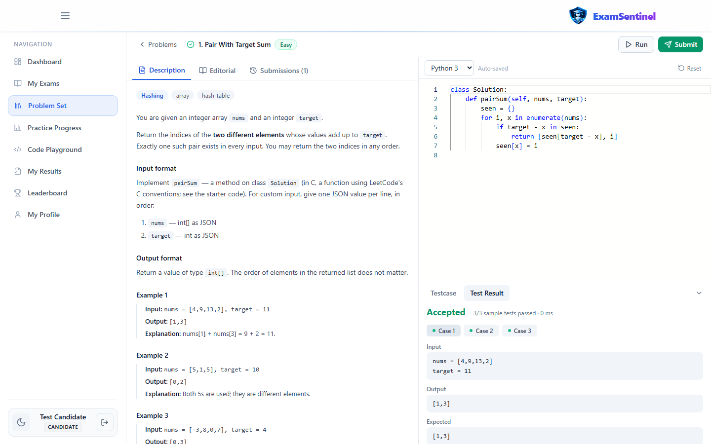
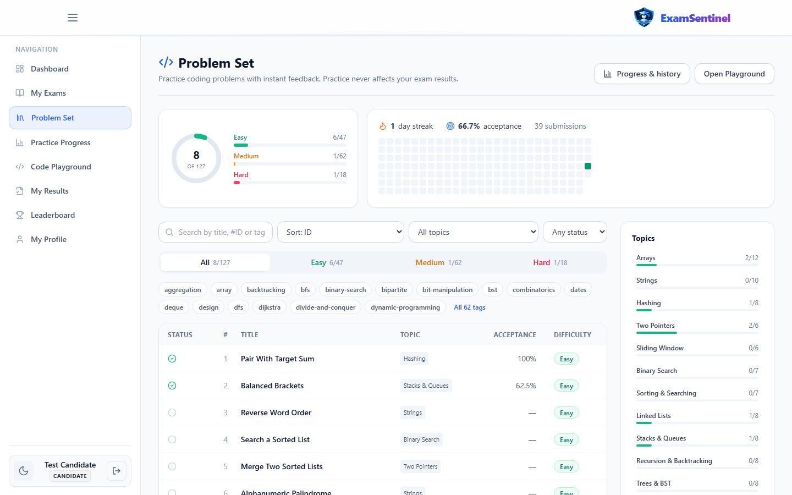
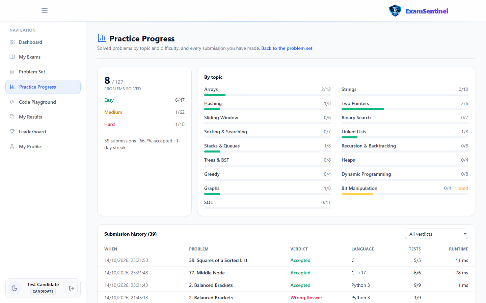
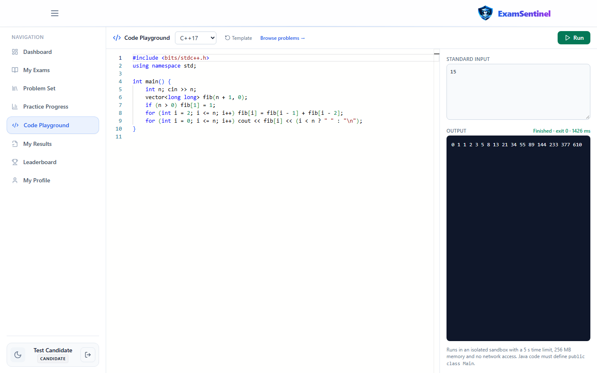
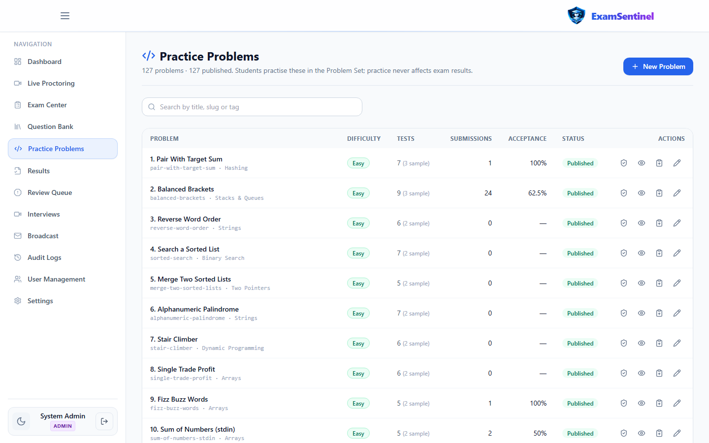
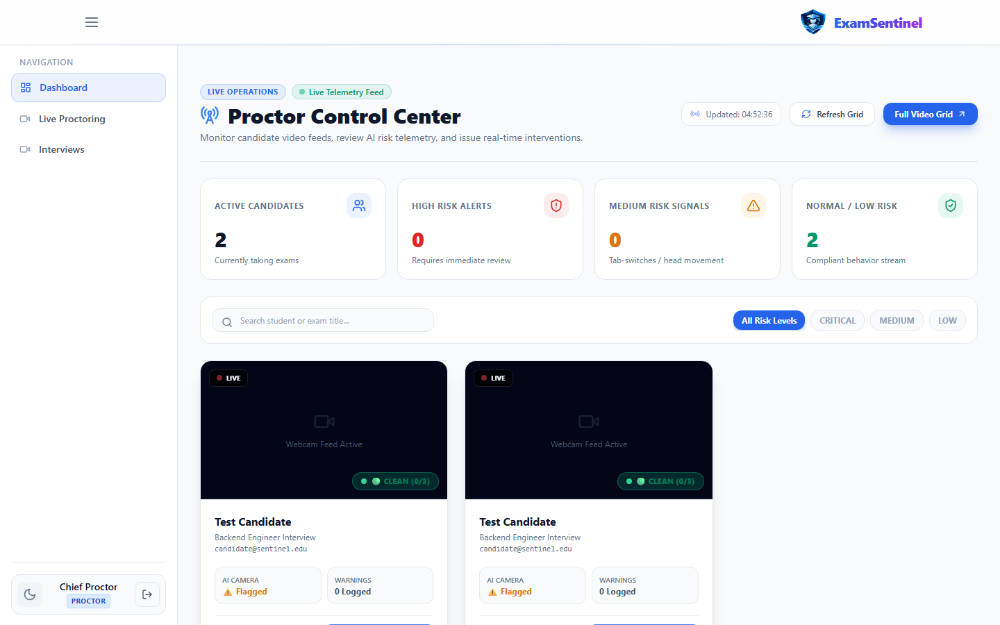
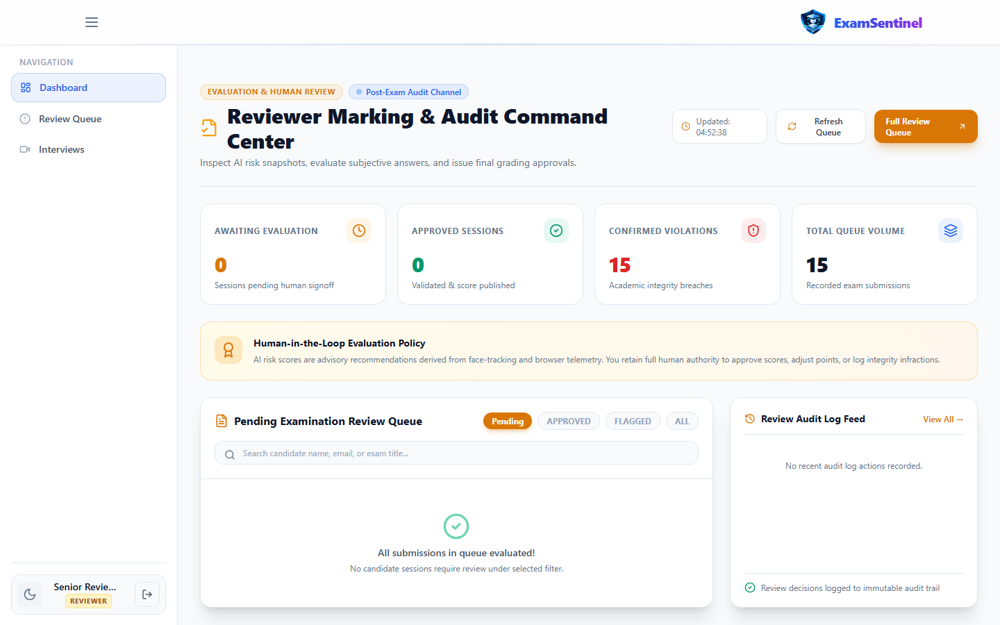
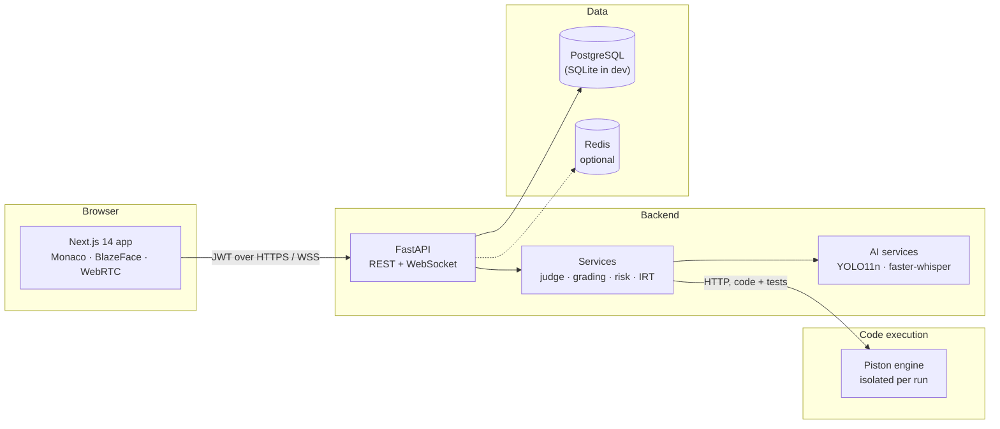

<div align="center">


# ExamSentinel

**Secure online assessments with AI-assisted proctoring and a built-in coding practice platform.**

[](https://github.com/vishwa-10147/ExamSentiinel/actions/workflows/ci.yml)


[](LICENSE)

[Features](#features) ·
[Screenshots](#screenshots) ·
[Getting started](#getting-started) ·
[Architecture](#architecture) ·
[Documentation](#documentation) ·
[Roadmap](#roadmap)

<br />



</div>

---

## Overview

ExamSentinel is a full-stack platform for running proctored exams and coding assessments.
Institutions build exams from a question bank, candidates take them in the browser while
integrity signals are collected, and human reviewers make every final decision. Alongside
exams, students get a LeetCode-style practice platform with **116 data-structures and
algorithms problems** and **11 SQL problems**, judged by real compilers in an isolated sandbox.

AI is used to *surface* signals — never to penalise a candidate automatically.

## Features

### Assessments
- Exam builder with MCQ, short answer, essay, coding and SQL questions; scheduling windows and enrolment
- Timed sessions with server-side timing, auto-save and automatic submission at the deadline
- Coding questions graded against hidden tests; any practice problem can be added to an exam
- Results, CSV export, and an item-response-theory engine for adaptive testing

### Proctoring and review
- Browser telemetry: tab switches, fullscreen exits, copy/paste, multiple sessions
- Webcam analysis: phone and additional-person detection (YOLO11n), face presence (BlazeFace, in-browser)
- Weighted, advisory risk score (Low → Critical) that opens a review case
- Live proctor console, reviewer queue with evidence, and a complete audit log

### Coding practice
- **116 DSA problems** across 16 topics, plus 11 SQL problems — each with formats, constraints,
  samples, hidden tests, hints, complexity and an editorial
- Monaco editor with starter code in Python, JavaScript, Java, C++ and C (LeetCode-style C signatures)
- **Run** against samples and custom input; **Submit** against every hidden test
- Verdicts: Accepted, Wrong Answer, Time/Memory/Output Limit Exceeded, Runtime Error, Compile Error
- Topic and difficulty filters, search by ID, submission history and per-topic progress
- Code playground for any C, C++, Java, Python, JavaScript or SQL program with custom stdin

### Interviews and accounts
- Live WebRTC interviews with consent capture, rubric scoring and Whisper transcription
- Email/password and OpenID Connect single sign-on (Google, Microsoft, any OIDC provider)
- Role-based access for Admin, Proctor, Reviewer and Candidate

## Screenshots

| | |
|:---:|:---:|
|  |  |
| **Problem set** — filters, topics and progress | **Practice progress** — by topic, with full history |
|  |  |
| **Code playground** — any program, custom stdin | **Problem authoring** — validate, publish, add to exams |
|  |  |
| **Proctor console** — live sessions and risk | **Reviewer dashboard** — human-in-the-loop decisions |

Screenshots are generated from a running local instance with
[`frontend/scripts/capture-screenshots.mjs`](frontend/scripts/capture-screenshots.mjs).

## Architecture



User code never runs in the API process: every run goes to a self-hosted
[Piston](https://github.com/engineer-man/piston) engine that isolates it with no network,
a non-root user and CPU, memory, process, output and file-size limits. Details in
[Architecture](docs/ARCHITECTURE.md) and [Code execution](docs/CODE_EXECUTION.md).

### Tech stack

| Layer | Technologies |
|---|---|
| Frontend | Next.js 14 (App Router), React 18, TypeScript, Tailwind CSS, Monaco Editor |
| Backend | Python 3.12, FastAPI, Pydantic v2, SQLAlchemy 2 (async), Alembic |
| Data | PostgreSQL 16 (production), SQLite (local development), Redis (optional) |
| Code execution | Piston — Python 3.12, Node 20, Java 15, GCC 10.2 (C/C++), SQLite 3.36 |
| AI | Ultralytics YOLO11n, BlazeFace (TensorFlow.js), faster-whisper |
| Infrastructure | Docker Compose, AWS (ECS, EC2, RDS, ElastiCache, S3), GitHub Actions |

## Getting started

### Prerequisites

- Python 3.12
- Node.js 20 LTS or newer
- Docker Desktop (runs the code-execution engine)

### Quick start on Windows

```bat
git clone https://github.com/vishwa-10147/ExamSentiinel.git
cd ExamSentiinel
start-local.cmd
```

`start-local.cmd` creates the virtual environment and configuration on first run, starts the
code-execution engine, the API and the web app, seeds demo data, waits until everything is
healthy and opens the browser. Stop everything with `start-local.cmd stop`.

### Manual setup (any OS)

```bash
# 1. Dependencies
python -m venv .venv
.venv/bin/python -m pip install -r backend/requirements.txt      # Windows: .venv\Scripts\python
(cd frontend && npm install)

# 2. Configuration (placeholders only — set SECRET_KEY)
cp .env.example backend/.env
echo "NEXT_PUBLIC_API_URL=http://localhost:8000" > frontend/.env.local

# 3. Code-execution engine
docker compose -f docker-compose.piston.yml up -d --build
.venv/bin/python scripts/install_piston_runtimes.py

# 4. Seed data
(cd backend && ../.venv/bin/python seed_admin.py && ../.venv/bin/python seed_practice.py)

# 5. Run
(cd backend && ../.venv/bin/python -m uvicorn app.main:app --port 8000) &
(cd frontend && npm run dev)
```

Open <http://localhost:3000>. The API reference is served at <http://localhost:8000/docs>.
To run the whole stack in containers instead, see [Installation](docs/INSTALLATION.md#2-docker-compose-full-stack).

### Demo accounts

`seed_admin.py` creates these accounts in **development only** (production seeds a single
admin from `ADMIN_EMAIL` / `ADMIN_PASSWORD`):

| Role | Email | Password |
|---|---|---|
| Admin | `admin@sentinel.edu` | `DemoPass123!` |
| Proctor | `proctor@sentinel.edu` | `DemoPass123!` |
| Reviewer | `reviewer@sentinel.edu` | `DemoPass123!` |
| Candidate | `candidate@sentinel.edu` | `DemoPass123!` |

Each account allows one active session; signing in elsewhere ends the previous one.

## Configuration

All settings are environment variables, documented in [`.env.example`](.env.example).
The most important ones:

| Variable | Purpose | Default |
|---|---|---|
| `SECRET_KEY` | JWT signing key | — (required) |
| `DATABASE_URL` | Database connection | SQLite file in `backend/` |
| `REDIS_URL` | Rate limits, OTPs, pub/sub (optional) | `redis://localhost:6379/0` |
| `PISTON_URL` | Code-execution engine | `http://localhost:2000/api/v2/execute` |
| `CORS_ORIGINS` | Allowed browser origins | `localhost:3000` |
| `SSO_*` | OpenID Connect providers | disabled |
| `NEXT_PUBLIC_API_URL` | API base URL used by the browser | `http://localhost:8000` |

## Coding practice

| Topic | Problems | Topic | Problems |
|---|:---:|---|:---:|
| Arrays | 12 | Stacks & Queues | 8 |
| Strings | 10 | Recursion & Backtracking | 8 |
| Hashing | 8 | Trees & BST | 8 |
| Two Pointers | 6 | Heaps | 4 |
| Sliding Window | 6 | Greedy | 4 |
| Binary Search | 7 | Dynamic Programming | 8 |
| Sorting & Searching | 7 | Graphs | 8 |
| Linked Lists | 8 | Bit Manipulation | 4 |

**116 DSA problems** (43 Easy, 57 Medium, 16 Hard) and **11 SQL problems**. Every statement is
original; expected outputs are produced by executing reference solutions, and every reference
passes its own tests on the real engine. See the [question bank](docs/DSA_QUESTION_BANK.md)
for the full index and authoring guide.

| | Python | JavaScript | Java | C++ | C | SQL |
|---|:---:|:---:|:---:|:---:|:---:|:---:|
| Function-style problems | ✓ | ✓ | ✓ | ✓ | ✓ | |
| Stdin/stdout problems | ✓ | ✓ | ✓ | ✓ | ✓ | |
| SQL problems | | | | | | ✓ |
| Playground | ✓ | ✓ | ✓ | ✓ | ✓ | ✓ |

## Testing

| Suite | Command | Scope |
|---|---|---|
| Backend | `cd backend && pytest -q -p no:cacheprovider` | Unit, API, question bank, real-engine isolation and every reference solution |
| Type check | `cd frontend && npx tsc --noEmit` | Frontend types |
| Browser | `cd frontend && npx playwright test` | Route protection and role journeys |
| End to end | `python scripts/e2e_roles_smoke.py` | Full exam lifecycle against running servers |

Real-engine tests run only when Piston is reachable and are reported as skipped otherwise.
Latest recorded results are in [Testing](docs/TESTING.md).

## Project structure

```
ExamSentinel/
├── backend/
│   ├── app/               # FastAPI application: api/, core/, models/, schemas/, services/
│   ├── practice_bank/     # DSA and SQL question bank
│   ├── alembic/           # Database migrations (PostgreSQL)
│   └── tests/             # pytest suites
├── frontend/
│   ├── app/               # Next.js routes: admin/, candidate/, proctor/, reviewer/, exam/, auth/
│   ├── components/        # Shared UI components
│   ├── services/          # API client
│   └── tests/             # Playwright specs
├── ai/                    # Standalone AI modules and model weights
├── infra/piston/          # Code-execution engine image
├── scripts/               # Seeding, runtime installation, end-to-end checks
├── docs/                  # Documentation
├── docker-compose.yml     # Full local stack
├── docker-compose.prod.yml
└── start-local.cmd        # One-command local start (Windows)
```

## Deployment

The production stack runs the web app and API in containers on ECS, PostgreSQL on RDS, Redis on
ElastiCache, evidence in S3, and the code-execution engine on a dedicated EC2 instance in a
private subnet. Step-by-step instructions: [AWS deployment](docs/AWS_DEPLOYMENT.md).

## Security

- Untrusted code runs only in the sandbox; isolation and limits are verified by automated tests
- Hidden tests, reference solutions and checkers are never sent to the browser
- Browser sessions in httpOnly cookies with CSRF protection; tokens are never readable by page scripts
- Role-based authorisation on every endpoint; rate limits on sign-in and code execution, with or without Redis
- Secrets come from the environment; nothing secret is committed or exposed to the frontend

Every control and the test that verifies it is listed in the [security policy](docs/SECURITY.md),
together with known limitations. Please report vulnerabilities privately.

## Documentation

| Document | Contents |
|---|---|
| [Installation](docs/INSTALLATION.md) | Native and Docker setup, troubleshooting |
| [Architecture](docs/ARCHITECTURE.md) | Components, data model, request flow |
| [API reference](docs/API.md) | Practice and code-execution endpoints with examples |
| [Code execution](docs/CODE_EXECUTION.md) | Sandbox, judge modes, verdicts, limits |
| [Question bank](docs/DSA_QUESTION_BANK.md) | Problem index and authoring guide |
| [Security](docs/SECURITY.md) | Verified controls and known gaps |
| [Staff guide](docs/STAFF_GUIDE.md) | Running exams, reviewing, managing problems |
| [AWS deployment](docs/AWS_DEPLOYMENT.md) | Production deployment |
| [Testing](docs/TESTING.md) | Test suites, how to run them and latest results |
| [Contributing](docs/CONTRIBUTING.md) | Workflow and engineering rules |

## Roadmap

- [x] DSA question bank with 116 problems and verified reference solutions
- [x] Sandboxed multi-language judge with checkers for multi-answer problems
- [x] OpenID Connect single sign-on and live interviews with transcription
- [x] C support for function-style problems with LeetCode-style signatures
- [x] httpOnly cookie sessions with CSRF protection; brute-force throttling without Redis
- [ ] Queued judging for exam-day load across multiple engine instances
- [ ] Timed contests and curated study plans

## Contributing

Contributions are welcome. Please read the [contributing guide](docs/CONTRIBUTING.md) — in
particular, AI output must stay advisory, user code must never run in the API process, and
security claims need a test that proves them.

## License

Released under the [MIT License](LICENSE).

## Acknowledgements

[Piston](https://github.com/engineer-man/piston) ·
[Ultralytics YOLO](https://github.com/ultralytics/ultralytics) ·
[faster-whisper](https://github.com/SYSTRAN/faster-whisper) ·
[Monaco Editor](https://github.com/microsoft/monaco-editor) ·
[FastAPI](https://fastapi.tiangolo.com) ·
[Next.js](https://nextjs.org)
