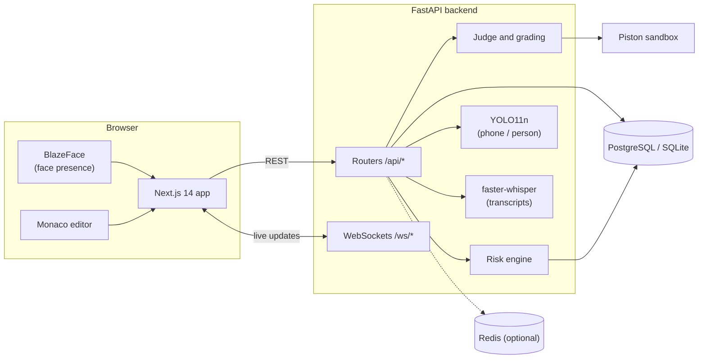
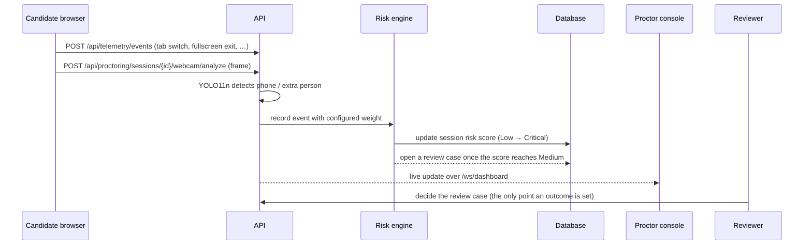
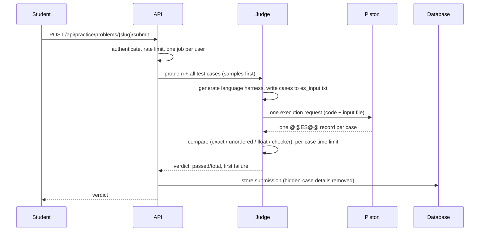
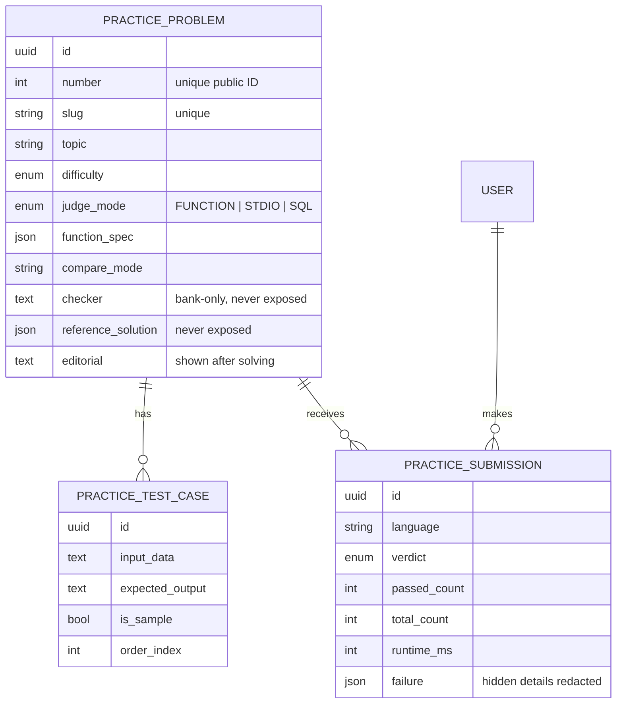

# Architecture

How ExamSentinel is structured, how data flows through it and the design rules that hold it
together.

## Contents

- [System overview](#system-overview)
- [Components](#components)
- [Proctoring signal flow](#proctoring-signal-flow)
- [Judging a submission](#judging-a-submission)
- [Practice data model](#practice-data-model)
- [Deployment topologies](#deployment-topologies)
- [Design principles](#design-principles)

## System overview

The browser talks to the API over HTTPS with a JWT in the `Authorization` header and receives
live updates over WebSockets. The API persists to PostgreSQL (SQLite in local development),
uses Redis when available, and sends all user code to the Piston sandbox over HTTP.

## Components

| Component | Location | Responsibility |
|---|---|---|
| Web app | `frontend/` | Next.js 14 App Router, TypeScript, Tailwind. One API client (`services/apiClient.ts`); each role area is wrapped by `RoleAreaLayout` |
| API | `backend/app/api/` | Routers mounted under `/api` (`router.py`); WebSockets under `/ws` |
| Services | `backend/app/services/` | `practice_judge` (judge), `sandbox_service` (engine client), `grading_service`, `risk_engine`, `irt_service`, `transcription_service`, `sso_service` |
| Models | `backend/app/models/` | SQLAlchemy 2 (async). Migrations in `backend/alembic/versions/` |
| Question bank | `backend/practice_bank/`, `backend/seed_practice.py` | Problem definitions and the seeder — see [Question bank](DSA_QUESTION_BANK.md) |
| Code execution | `infra/piston/`, `docker-compose.piston.yml` | Self-hosted Piston image — see [Code execution](CODE_EXECUTION.md) |
| AI modules | `ai/` | Standalone research modules and model weights (`ai/models/yolo11n.pt`); the API uses `app/services/*` |

## Proctoring signal flow

Signals are de-duplicated over short windows so one incident is not counted repeatedly.
Proctors can warn a candidate or end a session; neither the risk score nor any AI detection
changes a candidate's result on its own.

## Judging a submission

Exam questions created from practice problems store a `practice_problem_id`; the grading
service judges a candidate's final answer in the same way.

## Practice data model

Relevant migrations: `012_practice_problems`, `013_practice_sql_problems` and
`014_practice_dsa_metadata`. Progress (solved and attempted per topic and difficulty, streaks)
is computed from submissions rather than stored.

## Deployment topologies

| Topology | Components | Guide |
|---|---|---|
| Local development | API and web app run natively (SQLite, no Redis); Piston in Docker | [Installation](INSTALLATION.md) |
| Docker Compose | PostgreSQL, Redis, API, web app and Piston containers | [Installation](INSTALLATION.md#2-docker-compose-full-stack) |
| AWS | ECS for the app, EC2 for Piston (it must run privileged), RDS, ElastiCache, S3 | [AWS deployment](AWS_DEPLOYMENT.md) |

## Design principles

- **AI is advisory.** Risk scores and detections inform people; they never decide outcomes.
- **Untrusted code never runs in the API process.** Only bank-provided checkers, which are
  repository code, run there.
- **Hidden data stays on the server.** Hidden tests, reference solutions and checkers never
  reach the browser.
- **Redis is optional.** Every Redis call has a fallback behind a circuit breaker, so an outage
  degrades features instead of failing requests.
- **Schema changes ship with migrations.** Postgres-only SQL is guarded by a dialect check.

---

[Back to README](../README.md) · [Documentation index](README.md)
